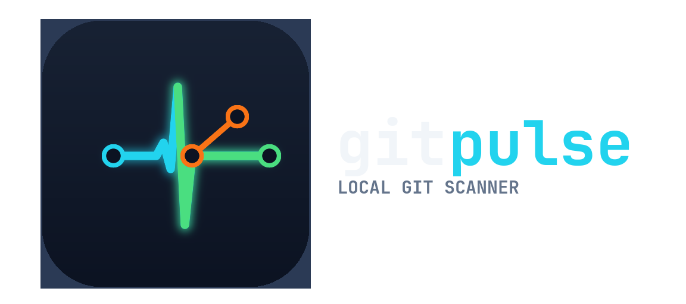

<div align="center">



# gitpulse

**Scan your workspace. Feel the pulse of every repo.**

A blazing-fast, dependency-free C++17 workspace manager that walks your
directory tree, finds every local Git repository, and reports its pulse.

[](LICENSE)
[](https://isocpp.org)
[](https://cmake.org)
[](#)

</div>

---

## Why

If you keep dozens of clones under `~/projects`, `~/work`, and a scratch dir
somewhere, you already know the feeling: *"wait, which folder was that repo
in?"* `gitpulse` answers that in one pass — point it at a directory and it
walks the tree, spots every Git repository, and tells you where it lives and
how heavy it is. No `find` gymnastics, no spawned `git` processes, no
runtime dependencies. Just a single static binary and the filesystem.

## Features

- **Lightning-fast scanning** — recursive directory walk powered by
  `std::filesystem`, delivering results in milliseconds.
- **Repository detection** — identifies any directory containing a `.git`
  entry, so nested workspaces and mono-repo checkouts are all found.
- **Pulse report** — prints each repository's name, path, and on-disk size
  in one clean table.
- **Zero dependencies** — no libgit2, no Boost, no network calls. The
  standard library is the whole story.
- **Modern C++** — built on C++17 with RAII and smart pointers. No bloat,
  no external dependencies.
- **Sensible defaults** — run it with no arguments and it scans the current
  directory; pass a path to scan anywhere.

## Demo

```
$ cd ~/projects
$ ./git_pulse
🚀 GitPulse Scanner Initialized
Scanning path: .

Successfully mapped 3 repos:
--------------------------------------------------
📄 Name: git-pulse
   Path: ./git-pulse
   Size: 284672 bytes
--------------------------------------------------
📄 Name: dotfiles
   Path: ./dotfiles
   Size: 90112 bytes
--------------------------------------------------
📄 Name: scanner-experiments
   Path: ./scanner-experiments
   Size: 1572864 bytes
--------------------------------------------------
```

## Requirements

| Tool    | Version |
| ------- | ------- |
| C++ compiler with C++17 support | GCC 9+, Clang 10+ |
| CMake   | ≥ 3.15  |
| Linux   | any modern distro (developed against Wayland sessions) |

## Building from Source

```bash
git clone https://github.com/ghb-n/git-pulse.git
cd git-pulse

mkdir -p build && cd build
cmake ..
make
```

The binary lands at `build/git_pulse`. Copy it somewhere on your `PATH`, or
just run it from the build directory:

```bash
./build/git_pulse
```

## Usage

```bash
gitpulse [path]
```

- **no arguments** — scans the current working directory (`.`)
- **`path`** — scans that directory instead

```bash
gitpulse ~/projects     # scan a specific workspace
gitpulse /srv/git       # scan anywhere
```

If the target doesn't exist or isn't a directory, the scanner prints an error
to `stderr` and returns an empty result set rather than crashing.

## How It Works

1. `Scanner::scanfiles()` opens a `std::filesystem::recursive_directory_iterator`
   over the target path.
2. Each entry is probed for a `.git` directory — the signal that the folder
   is a repository root.
3. Matches are collected into a `FileInfo` record (`RepoName`, `RepoPath`,
   `FileSize`) and keyed into an `unordered_map` for O(1) lookups.
4. Errors are handled per-entry — an unreadable file is reported and
   skipped, never fatal to the whole scan.

```
src/main.cpp          entry point & pretty-printing
src/scanner.cpp       directory walking & repository detection
include/scanner.h     Scanner class + FileInfo struct
include/repo.h        repository metadata (WIP)
```

Community standards: [CONTRIBUTING.md](CONTRIBUTING.md) ·
[code of conduct](https://www.contributor-covenant.org/version/2/1/code_of_conduct/)

## Roadmap

The scanner core is in place; these are the planned additions to the pulse
report:

- [ ] Dirty-flag detection — uncommitted changes vs. staged vs. clean
- [ ] Ahead/behind commit counts against the tracking remote
- [ ] Colorized TUI-style output
- [ ] Machine-readable output (JSON) for scripting
- [ ] `.gitignore`-aware depth control

## Contributing

Contributions are welcome — bug reports, feature ideas, and pull requests all
help. See [CONTRIBUTING.md](CONTRIBUTING.md) for the development setup, the
coding style used in this project, and the pull request checklist. Please keep
the C++17 / zero-dependency constraint intact.

## License

Released under the [GNU General Public License v3.0](LICENSE) — you are free
to use, modify, and redistribute, provided derivative works stay under the
same license. See `LICENSE` for the full text.

---

<div align="center">

Built with `std::filesystem` and too much coffee.

</div>
